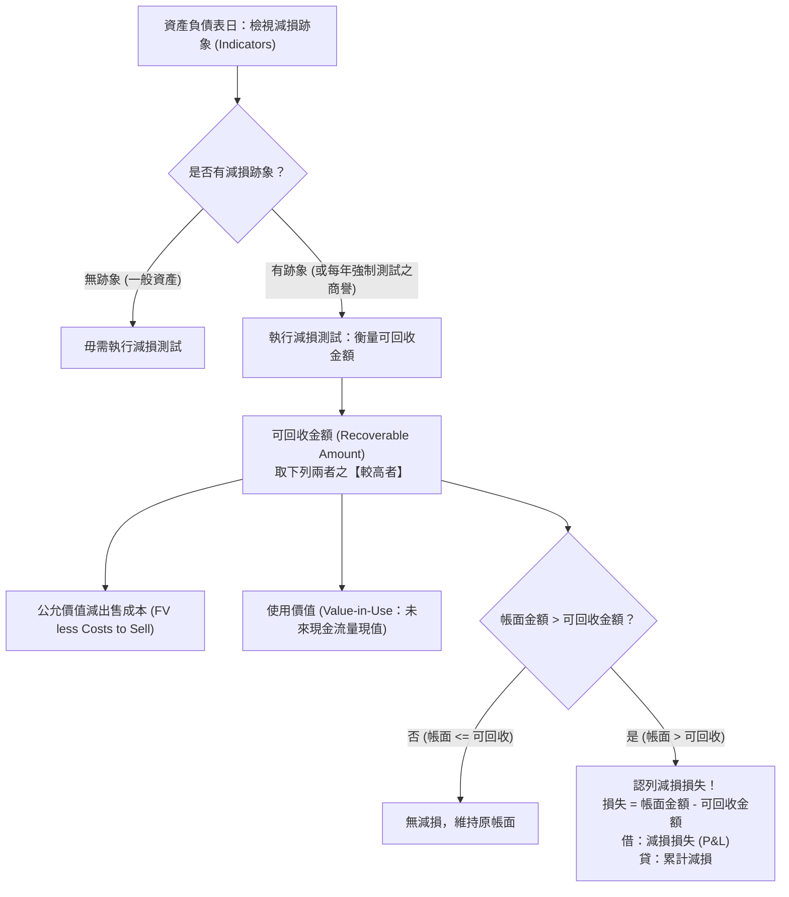

# IAS 36 資產減損模型 (Impairment of Assets)

## 1. 減損概念與評估架構

依據 **IAS 36《資產減損》(Impairment of Assets)**，企業所持有的長期資產，其帳面金額不得高於透過使用或出售所能收回之金額。當**帳面金額 (Carrying Amount)** 高於**可回收金額 (Recoverable Amount)** 時，資產即發生減損，必須將差額認列為**減損損失 (Impairment Loss)**。

---

## 2. 可回收金額之雙軌計量（取較高者）

可回收金額之所以取兩者之**較高者 (Higher of)**，是基於理性經理人決策假設：
* 若出售價格較高，理性企業會選擇將資產出售；
* 若持續使用所創造的現金流折現值較高，企業會選擇保留營運。

1. **公允價值減出售成本 (Fair Value less Costs to Sell)**：
   * 在熟悉情況且具交易意願之雙方，於公平交易中出售資產所能取得之金額，扣除直接可歸屬之增額處分成本。
2. **使用價值 (Value-in-Use, VIU)**：
   * 預期由該資產持續使用及使用壽命結束時之處分，所產生之**估計未來現金流量折現值**。
   * 折現率應採反映貨幣時間價值及該資產特定風險之稅前市場利率。

---

## 3. 現金產生單位 (CGU) 與商譽分攤順序

當單一設備或資產**無法獨立產生現金流入**時，減損測試必須以該資產所屬之**現金產生單位 (Cash-Generating Unit, CGU)** 為基礎進行。
* **CGU 定義**：係指可產生實質上獨立於其他資產或資產組合之現金流入的**最小可辨認資產組合**。

### 3.1 減損損失分攤順序（嚴格兩階段）
當 CGU 之帳面金額大於可回收金額時，認列之減損損失應按下列順序分攤沖減：
1. **第一階段（商譽最先受損）**：
   * 優先沖減分攤至該 CGU 之**商譽 (Goodwill)** 帳面金額，直至商譽帳面金額降為零！
2. **第二階段（其他資產按比例分攤）**：
   * 超過商譽金額之剩餘減損損失，依該 CGU 內**各項其他資產之相對帳面金額比例 (Pro-rata Basis)** 進行分攤。
3. **分攤下限保護**：
   * 任何個別資產分攤減損損失後之帳面金額，**不得低於**該資產獨立之公允價值減出售成本、使用價值（若可衡量）及零之最高者。

---

## 4. 減損損失之後續折舊與迴轉限制 (Reversals)

### 4.1 減損後之折舊提列
認列減損損失後，資產以**新的可回收金額（新帳面價值）**為基礎，於剩餘耐用年數內重新提列每期折舊。

### 4.2 減損迴轉規則與天花板 (Cap on Reversal)
* 若後續期間導致減損之經濟環境好轉，原先認列之減損損失可予迴轉，貸記**「減損迴轉利益 (Gain on Reversal of Impairment Loss - P&L)」**。
* **嚴格上限天花板**：
  $$\text{迴轉後帳面金額上限} = \text{該資產在「假設過去從未認列減損」情況下，截至當期應有之折舊後帳面價值}$$
  * 亦即：減損迴轉**絕不能使資產帳面價值反超其原始歷史成本扣除常態累計折舊之金額**！
* **商譽禁止迴轉條款**：
  * IAS 36 嚴格禁止：**分攤予商譽之減損損失，後續期間在任何情況下皆絕對不得迴轉**！

---

## 5. 待處分資產之減損 (Assets Held for Disposal / IFRS 5)

* 當企業決定透過出售處分長期資產時，該資產轉分類為待出售非流動資產（IFRS 5）。
* **衡量基礎**：按「帳面金額」與「公允價值減出售成本（淨變現價值）」孰低衡量。
* **核心規定**：
  1. **持有待處分期間，完全停止提列任何折舊或攤銷**！
  2. 後續期間若淨變現價值回升，可認列回升利益，但以轉入待售資產前累計認列之減損損失為限。
