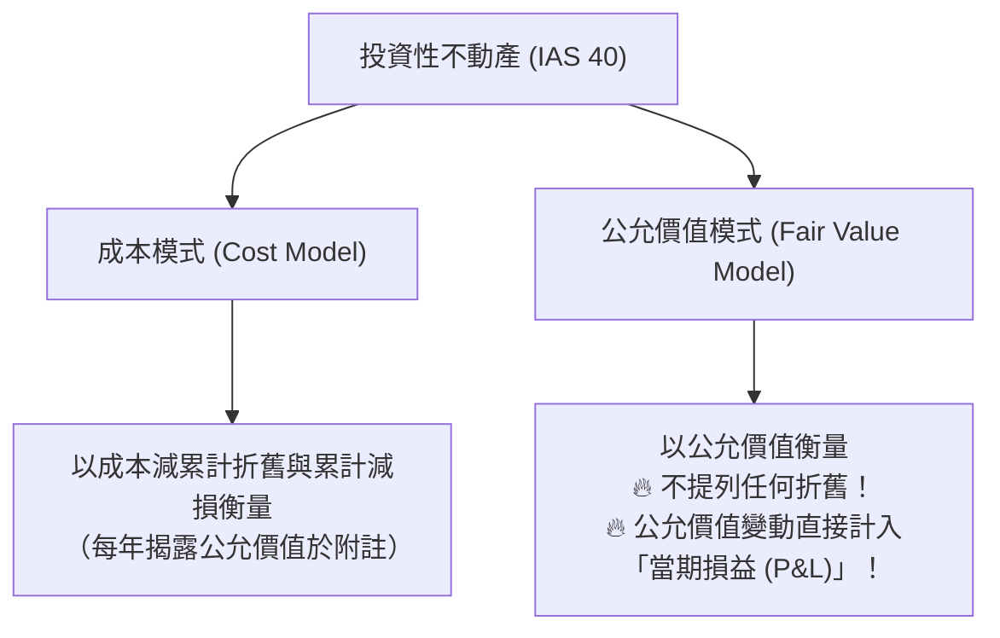

# 投資性不動產 (Investment Property - IAS 40)

## 1. 定義與範圍界定

依據 **IAS 40《投資性不動產》(Investment Property)**，投資性不動產係指為**賺取租金**、**資本增值（長期資產上漲）**，或兩者兼具，而由所有者或使用權資產承租人所持有之**土地**或**建築物**（或建築物之一部分）。

### 1.1 排除項目（不屬於 IAS 40）
1. **自用不動產 (Owner-Occupied Property)**：供生產、提供商品或勞務、或行政管理目的使用之不動產 $\rightarrow$ 依 **[[wiki/standards/ias16_ppe|IAS 16 不動產、廠房及設備]]** 處理。
2. **通常營業過程中供出售之不動產**：建商準備出售的成屋、代售的房地產 $\rightarrow$ 依 **IAS 2 存貨** 處理。

---

## 2. 後續衡量雙軌模式 (Dual Subsequent Measurement Models)

企業應就其**所有**投資性不動產選擇下列模式之一作為會計政策，且一經選定即應一致套用：



### 2.1 成本模式 (Cost Model)
* 依 IAS 16 成本模式之原則：以原始成本扣除**累計折舊 (Accumulated Depreciation)** 及任何**累計減損損失 (Accumulated Impairment Losses)** 衡量。
* **特別要求**：採成本模式者，仍須在財務報表附註中充分揭露該投資性不動產之公允價值。

### 2.2 公允價值模式 (Fair Value Model)
* **核心規定**：
  1. 於每個資產負債表日，將投資性不動產重新衡量至當前公允價值。
  2. **完全不提列折舊 (NO Depreciation is recognized)**！
  3. 公允價值變動產生之未實現利得或損失，**全數直接計入當期損益 (Profit or Loss)**！

---

## 3. IAS 40 公允價值模式 vs. IAS 16 重估價模式（考點核心）

許多初學者極易混淆 **IAS 40 的公允價值模式** 與 **IAS 16 PP&E 的重估價模式 (Revaluation Model)**，兩者存在根本性差異：

| 比較維度 | IAS 40 投資性不動產（公允價值模式） | IAS 16 PP&E 自用不動產（重估價模式） |
| :--- | :--- | :--- |
| **持有目的** | 賺取租金或資本增值 | 供生產、營業或行政自用 |
| **折舊提列** | **完全不提列折舊** | **仍須按重估後金額持續提列折舊** |
| **公允價值上漲處理** | **計入當期損益 (Profit or Loss)**<br/>（直接影響 EPS 與營業外淨利） | **計入其他綜合損益 (OCI)**<br/>（列於權益項下「重估增值」儲備） |
| **公允價值下跌處理** | **計入當期損益 (Profit or Loss)** | 先沖減既有之重估增值，超額部分始入損益 |

---

## 4. 經典釋例：Hakodate Group (Illustration 7A.1)

Hakodate 集團於 2025 年 1 月 1 日以 $¥50,000,000$ 購買一棟商用大樓，持有目的為出租賺取租金，分類為投資性不動產並採用**公允價值模式**。該大樓估計耐用年限 40 年。2025 年 12 月 31 日，該大樓經鑑價之公允價值為 $¥54,000,000$。

### 4.1 2025 年 1 月 1 日（取得）
```text
借：投資性不動產 (Investment Property)           ¥50,000,000
    貸：現金 (Cash)                                        ¥50,000,000
```

### 4.2 2025 年 12 月 31 日（期末衡量）
> 採公允價值模式，**不提列折舊**！公允價值增值 $¥4,000,000$ 直接認列損益：
```text
借：投資性不動產 (Investment Property)            ¥4,000,000
    貸：公允價值變動損益 (Gain on Fair Value Adjustment - P&L)   ¥4,000,000
```
*(若 Hakodate 採用成本模式且採直線法無殘值，則 2025 年底需提列折舊 $¥50,000,000 / 40 = ¥1,250,000$)*

---

## 5. 跨章節關聯

* [[wiki/sources/ch07_property_plant_equipment|Chapter 7 來源筆記]]
* [[wiki/journal-entries/ppe_acquisition_and_disposition|PP&E 分錄集合]]
* [[wiki/standards/ias16_ppe|IAS 16 不動產、廠房及設備]]
