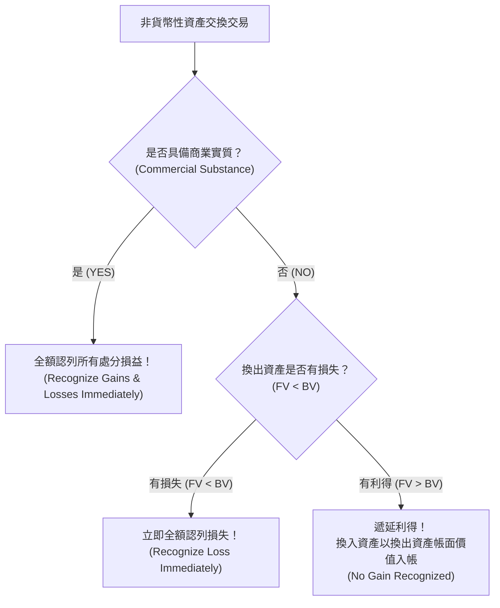

# 非貨幣性資產交換 (Non-Monetary Asset Exchanges - IAS 16)

## 1. 核心觀念與商業實質判定

企業以非貨幣性資產（如舊設備、土地、專利權）換取另一項非貨幣性資產（通常搭配少量現金補價），在 IAS 16 準則下，入帳價值與損益認列之核心關鍵在於**商業實質 (Commercial Substance)**。

### 1.1 商業實質的定義條件
若一項交換交易符合下列**任一條件**，即具備商業實質：
1. **未來現金流量之風險、時限及金額**因該項交換而發生顯著改變（例如：以卡車換取辦公大樓，其經濟用途與現金流入完全不同）。
2. 被交換資產影響企業**特定營運部分的企業特定價值 (Entity-Specific Value)** 發生顯著改變，且該差異相對於換入換出資產之公允價值而言屬重大。

> [!NOTE]
> 簡言之：如果企業只是把兩台功能一模一樣、產生相同現金流的機器互相交換（例如兩家油商交換同品質存貨以節省運費），該交易**不具商業實質**；反之，若經營模式或現金流預期產生變化，則**具備商業實質**。

---

## 2. 損益認列與換入資產成本衡量規則

### 2.1 具商業實質 (Has Commercial Substance)
* **換入資產入帳成本**：
  $$\text{換入資產成本} = \text{換出資產公允價值} + \text{支付之現金補價} - \text{收取之現金補價}$$
  *(若換入資產之公允價值更為明確客觀，則以換入資產公允價值衡量)*
* **處分損益認列**：
  $$\text{處分損益} = \text{換出資產公允價值} - \text{換出資產帳面價值 (成本 - 累計折舊)}$$
  * **全數立即認列於當期損益 (Profit or Loss)**，不論利得或損失！

### 2.2 不具商業實質 (Lacks Commercial Substance)
準則基於**保守穩健原則**與**防止人為盈餘操縱**：
1. **損失情況 (FV < BV)**：
   * 遵循資產減損原則，**損失必須立即全額認列**！
   * 換入資產成本以「換出資產公允價值 + 支付補價」入帳。
2. **利得情況 (FV > BV)**：
   * **不得認列交換利得 (Defer Gain)**！
   * 換入資產入帳成本必須以**換出資產帳面價值 (Book Value)** 為基礎調整：
     $$\text{換入資產成本} = \text{換出資產帳面價值} + \text{支付之現金} - \text{收取之現金}$$
   * 遞延之利得隱含在換入資產較低的帳面價值中，未來將透過較少的每期折舊費用逐步實現。

---

## 3. 典型分錄與對照表

| 情境類別 | 商業實質 | 利得/損失狀態 | 處分損益認列 | 換入資產衡量基準 |
| :--- | :---: | :---: | :---: | :--- |
| **情況 A** | 具備 | 處分損失 | **立即全額認列損失** | 換出公允價值 + 支付補價 |
| **情況 B** | 具備 | 處分利得 | **立即全額認列利得** | 換出公允價值 + 支付補價 |
| **情況 C** | **不具備** | 處分損失 | **立即全額認列損失** | 換出公允價值 + 支付補價 |
| **情況 D** | **不具備** | 處分利得 | **不得認列（全額遞延）** | **換出帳面價值** + 支付補價 |

---

## 4. 跨章節關聯

* [[wiki/sources/ch07_property_plant_equipment|Chapter 7 來源筆記]]
* [[wiki/journal-entries/ppe_acquisition_and_disposition|PP&E 分錄與計算釋例]]
* 類似觀念：[[wiki/concepts/fair_value_hierarchy|公允價值層級 IFRS 13]]
