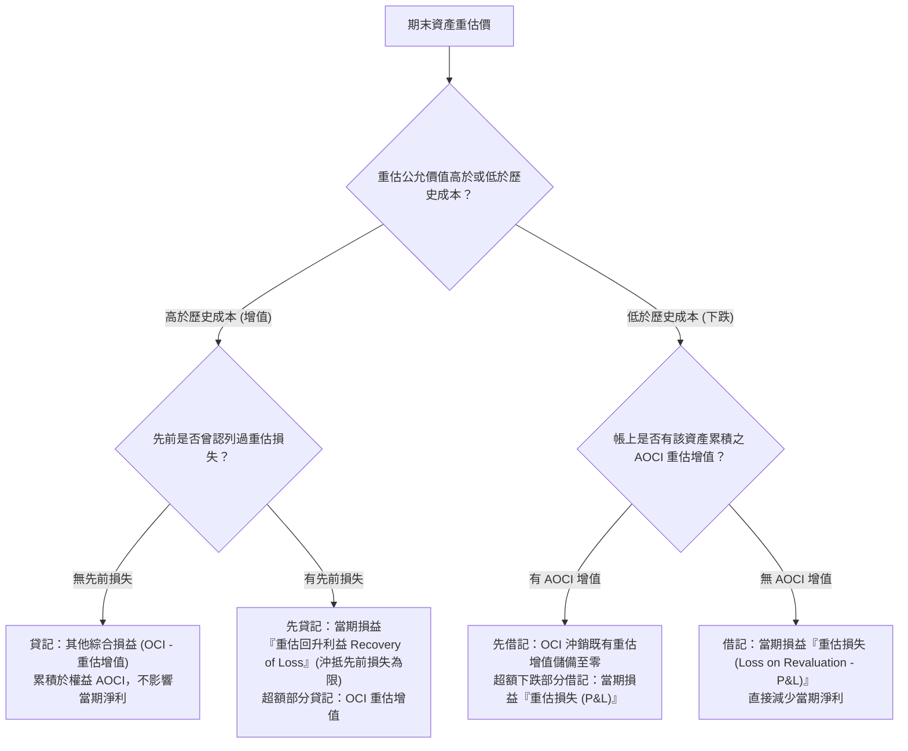

# IAS 16 PP&E 重估價模式機制與會計處置 (Appendix 8A)

## 1. 模式選擇與適用原則

依據 **IAS 16《不動產、廠房及設備》**，企業在初始取得 PP&E 後，可就各類別資產自選採用**成本模式 (Cost Model)** 或**重估價模式 (Revaluation Model)** 作為後續衡量政策：
* **資產類別一致性原則**：若選擇對某項資產（例如「土地」或「建築物」）採用重估價模式，則**同類別 (Same Class) 之所有資產均必須全部採用重估價模式**，以防止企業擇優重估、操縱財報！
* **持續更新頻率**：重估價必須具備足夠的頻繁度，以確保資產負債表日之帳面金額與公允價值不致發生重大差異。

---

## 2. 重估增值與減損認列之對稱性規則

IAS 16 對於重估價之損益處理，設計了極為精密的**「增值進權益 OCI、損失進損益 P&L」**防禦架構：



### 核心規則速記：
1. **第一次增值**：直入 **OCI（重估增值 Revaluation Surplus）**。
2. **第一次下跌**：直入 **當期損益 P&L（重估損失 Loss on Revaluation）**。
3. **先漲後跌**：先扣既有之 **AOCI 重估增值**，扣完不夠才進 **當期損益 P&L**。
4. **先跌後漲**：先貸記 **當期損益 P&L（重估回升利益）** 補回過去認列的損失，超過部分才入 **OCI 重估增值**。

---

## 3. 重估增值之後續處分與結轉 (Transfers of AOCI)

### 3.1 絕對禁止重分類至損益 (No Recycling to P&L)
許多初學者常見盲點：當重估增值的土地或廠房最終賣出時，是否可以把 AOCI 裡累積的重估增值轉回當期損益？
> [!CAUTION]
> **IAS 16 嚴格明文禁止重分類至損益 (No Recycling)**！
> 重估增值是已在 OCI 認列過的權益項目，當資產除列出售時，**只能直接結轉至「保留盈餘 (Retained Earnings)」**，絕對不得灌入當期損益！

### 3.2 兩種結轉至保留盈餘之方式：
1. **除列處分時一次性結轉**：
   * 當土地或設備出售報廢時，將該資產所屬之全部 AOCI 餘額轉入保留盈餘：
   ```text
   借：其他綜合損益－重估增值 (AOCI)
       貸：保留盈餘 (Retained Earnings)
   ```
2. **使用期間隨折舊差額逐期結轉（折舊性資產適用）**：
   * 每年將「依重估後帳面金額計提之折舊」與「依原始歷史成本計提之折舊」兩者間之**超額折舊差額**，自 AOCI 轉入保留盈餘。

---

## 4. 經典跨準則對照：IAS 16 重估價 vs. IAS 40 公允價值模式

| 比較維度 | IAS 16 PP&E 重估價模式 (Appendix 8A) | IAS 40 投資性不動產公允價值模式 (Appendix 7A) |
| :--- | :--- | :--- |
| **適用對象** | 供企業生產、營運、行政**自用**之不動產 | 賺取租金或長期資本增值之不動產 |
| **折舊提列** | **仍須按重估後金額持續提列每期折舊**！ | 🔥 **完全不提列任何折舊費用**！ |
| **公允價值上漲處理** | 計入 **其他綜合損益 (OCI)**<br/>（權益項下重估增值，不影響淨利） | 🔥 全數直接計入 **當期損益 (Profit or Loss)**！ |
| **處分時重估增值轉回** | **嚴禁轉入損益 (No Recycling)**，僅能結轉保留盈餘 | 處分利得直接計入當期損益 |
